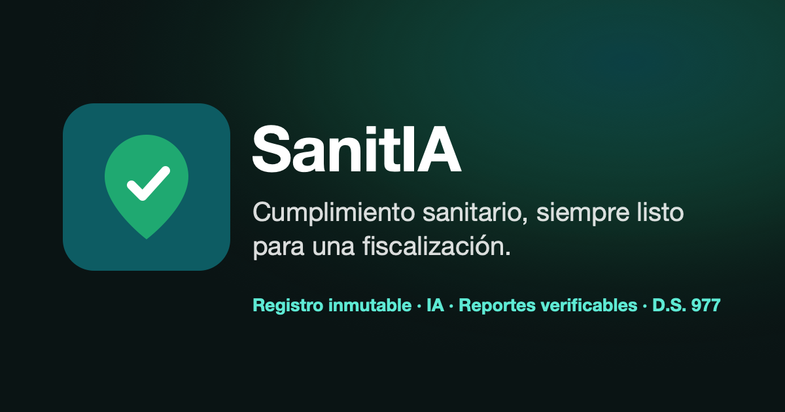
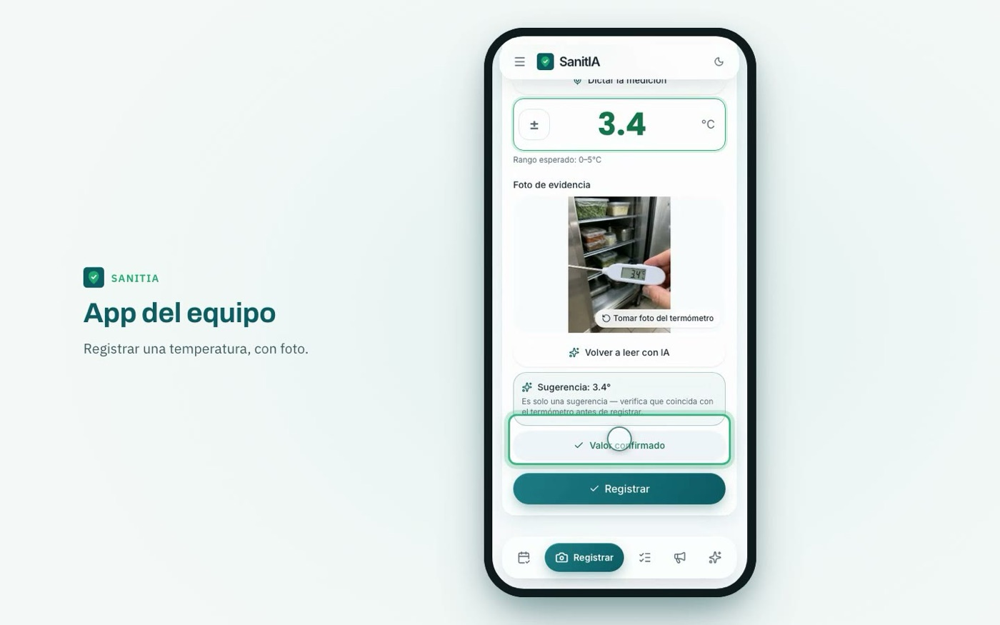
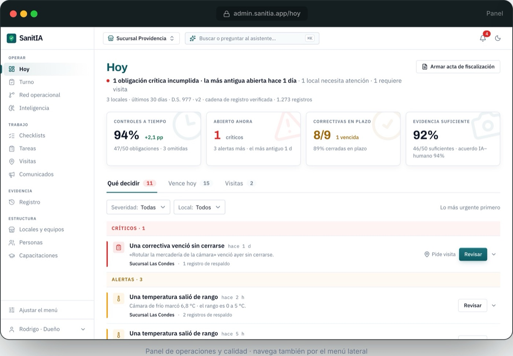
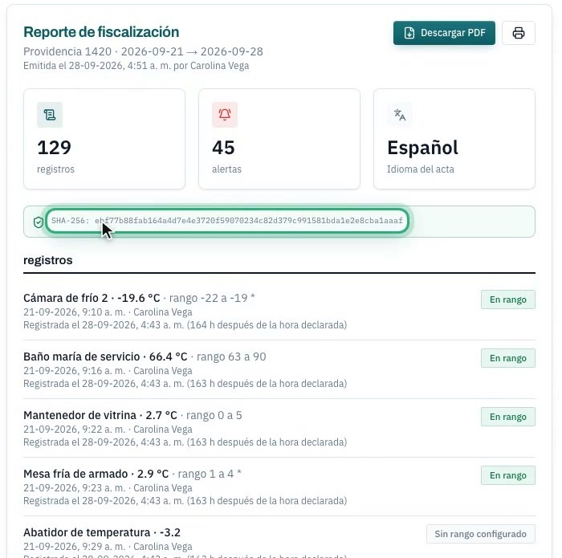
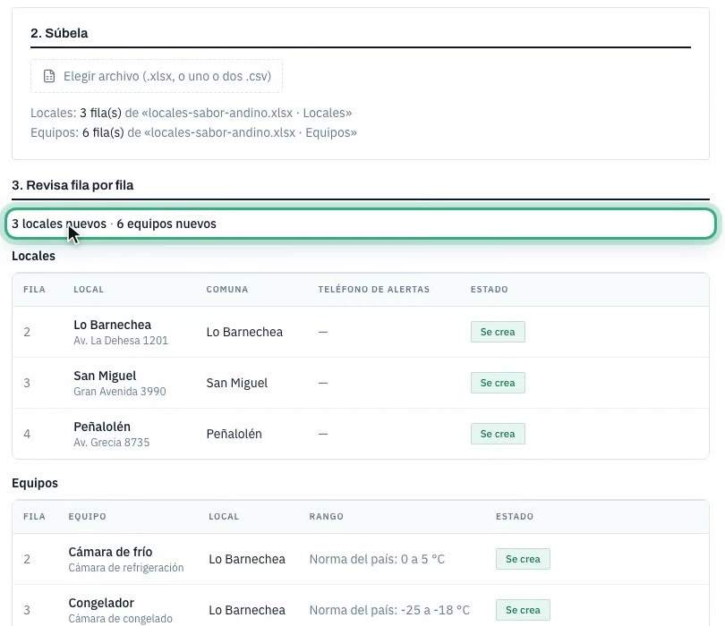
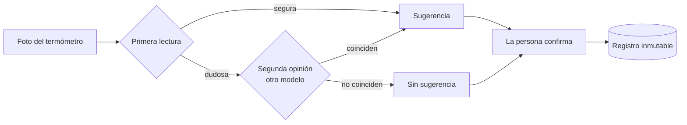
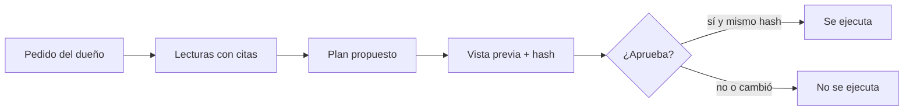
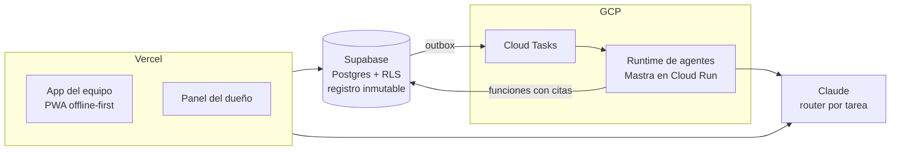

<p align="center">
  
</p>

<p align="center">
  <a href="https://sanitia.app"><b>sanitia.app</b></a> · <b>Español</b> · <a href="README.md">English</a>
</p>

<p align="center">
  
  
  
  
  
</p>

> **Repo de presentación.** El código es privado porque es un producto comercial. Aquí está qué es SanitIA, cómo está construido y las decisiones detrás.

## En 30 segundos

- **Qué es:** un SaaS que ayuda a restaurantes y negocios de comida a cumplir la normativa sanitaria. El equipo registra temperaturas con una foto, completa checklists y sube evidencias; el dueño ve qué está fuera de norma y genera un acta de fiscalización verificable.
- **Mi rol:** fundador y único desarrollador.
- **Lo distintivo:** el agente puede operar casi toda la app (más de 30 herramientas: crear locales y equipos, armar y publicar checklists, invitar al equipo, programar visitas, mandar comunicados, importar planillas) y hacerlo es seguro: toda acción pasa por un plan que la persona revisa y aprueba, y si el plan cambia antes de ejecutarse, no corre.

## El producto

<table>
  <tr>
    <td width="50%"></td>
    <td width="50%"></td>
  </tr>
  <tr>
    <td><b>App del equipo.</b> La IA lee el termómetro desde la foto y sugiere un valor. La persona lo confirma antes de registrar.</td>
    <td><b>Panel del dueño.</b> Qué decidir hoy, ordenado por urgencia y con el registro que respalda cada alerta.</td>
  </tr>
  <tr>
    <td></td>
    <td></td>
  </tr>
  <tr>
    <td><b>Acta de fiscalización.</b> Se genera desde el registro y lleva una huella SHA-256 que el fiscalizador puede verificar.</td>
    <td><b>Importar desde una planilla.</b> Se revisa fila por fila antes de crear nada. Lo que trae la planilla es dato, nunca instrucción para el agente.</td>
  </tr>
</table>

<sub>Capturas con datos de demostración.</sub>

## Decisiones del agente

La pregunta que guió el diseño: ¿cómo uso IA en un registro sanitario sin que un error de la IA termine como un registro falso?

### 1. La IA sugiere y la persona confirma

Ninguna temperatura se guarda sin confirmación humana: un dígito mal leído es un registro sanitario falso. Si la primera lectura es dudosa, un segundo modelo da una segunda opinión. Si no coinciden, no hay sugerencia y la persona registra a mano.



### 2. Toda escritura pasa por un plan aprobado

El asistente del dueño tiene más de 30 herramientas, pero las de escritura solo agregan pasos a un plan. Para ejecutarlo hacen falta la aprobación del usuario y un hash SHA-256 del plan: si el plan cambió entre la vista previa y la ejecución, no corre. Por eso un texto escondido en una planilla importada no puede ejecutar nada.



### 3. Lo que es regla no lo decide un modelo

Temperaturas, plazos, criticidad y omisiones son reglas deterministas. Las respuestas sobre normativa salen de un corpus con número de artículo, y cada cita se verifica: si el modelo cita algo que no está, se corrige y queda marcado.

### 4. Ningún agente recibe SQL libre

Los agentes leen solo con funciones fijas que devuelven citas, denominadores y procedencia. El runtime descarta cualquier propuesta que no se apoye en una alerta, un registro o una evidencia real.

### 5. Lo nuevo corre primero en sombra

La revisión semanal partió sin escribir en tablas de negocio, comparándose contra el camino existente, antes de habilitarse por organización.

### 6. Prohibido rankear personas

El asistente no puede rankear operadores ni recomendar sanciones, y un eval adversarial lo verifica.

### 7. Cambiar de modelo tiene un ciclo

Prueba de humo, evals adversariales al 100% y vuelta atrás con una sola variable. Lo aprendí cuando un cambio de modelo en producción dejó sin lectura de termómetro a los locales durante 6 minutos.

### 8. Cada llamada a la IA queda medida

Cada llamada registra la tarea, el modelo que respondió de verdad, tokens, costo, latencia y tres señales de calidad: si respondió el modelo de respaldo, si la respuesta se cortó y si la validación determinista la rechazó. La tasa de rechazo por tarea es el indicador de alucinación. Hay un tope de costo diario por local, y el contenido de las conversaciones nunca se guarda.

## Arquitectura



<details>
<summary><b>Estructura del monorepo</b></summary>

```
apps/pwa            app del equipo + landing pública (PWA offline-first)
apps/backoffice     panel del dueño y administración
apps/agent-runtime  runtime de agentes durable (Mastra en Cloud Run, outbox transaccional, Cloud Tasks idempotentes)
packages/agent      módulo de IA: visión, router de modelos (extraíble)
packages/ui         tokens de diseño, preset de Tailwind, primitivas compartidas
packages/checklists contratos del motor de checklists
packages/db-types   tipos generados desde la base (contrato versionado)
packages/i18n       mensajes base + ajustes por país
supabase/migrations única fuente de verdad del esquema multi-país (260+ migraciones)
e2e/                suites de Playwright: panel, PWA y sitio público
```

</details>

## Ingeniería de base

- **Registro inmutable.** Las filas de cumplimiento solo se insertan, y la base lo hace cumplir. Una corrección es una fila nueva que referencia a la original, así que la auditoría queda completa por construcción.
- **Multi-tenant con seguridad por fila.** RLS en todas las tablas de Supabase. Un Custom Access Token Hook pone la organización en el JWT, y las políticas fallan cerradas si falta.
- **PWA offline-first.** En las cocinas la señal es mala: la app registra localmente y sincroniza cuando vuelve la conexión.
- **El país es configuración.** Umbrales, términos y formatos viven en paquetes por país, validados con una matriz normativa. Agregar un país es cargar datos, no escribir código.
- **Guards que rompen la build.** Ninguna afirmación comercial sale sin evidencia aprobada, no se cuela un locale ni una zona horaria escrita a mano y el hook de autenticación tiene que estar activo.
- **Contrato de base tipado.** Los tipos se regeneran desde las migraciones en el mismo commit, y la verificación falla si no coinciden.
- **pgvector** para búsqueda semántica sobre normativa e inspecciones anteriores.

## Stack

Next.js (App Router) · TypeScript · Tailwind · Serwist (PWA) · Supabase (Postgres 17, Auth, Storage, pgvector) · Claude API · Mastra · Cloud Run · Cloud Tasks · next-intl · Playwright · monorepo con pnpm · Vercel

## Aviso

SanitIA es una herramienta de gestión y registro, no un servicio de certificación legal. Los umbrales son valores por defecto configurables que un experto en inocuidad alimentaria debe validar en cada país.

---

**Cristian Nieto** · [sanitia.app](https://sanitia.app) · [LinkedIn](https://linkedin.com/in/cnietoalbayay) · cnietoalbayay@gmail.com
