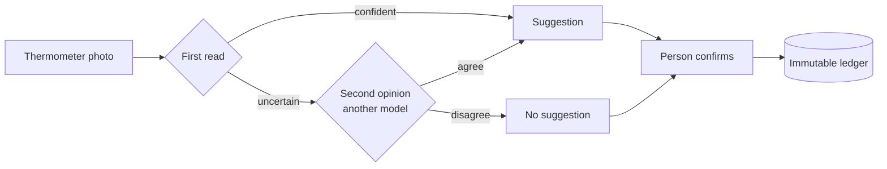
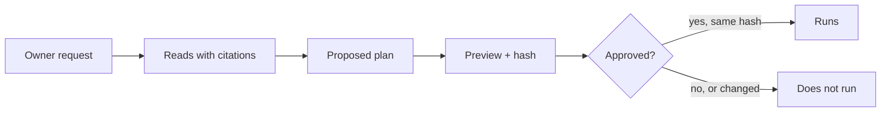
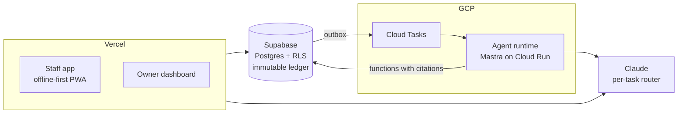

<p align="center">
  
</p>

<p align="center">
  <a href="https://sanitia.app"><b>sanitia.app</b></a> · <a href="README.es.md">Español</a> · <b>English</b>
</p>

<p align="center">
  
  
  
  
  
</p>

> **Overview repo.** The source code is private because SanitIA is a commercial product. This page covers what it is, how it is built and the decisions behind it. Ask me for a demo.

## In 30 seconds

- **What it is:** a SaaS that helps restaurants and food businesses comply with health regulations. Staff log temperatures with a photo, complete checklists and upload evidence; the owner sees what is out of spec and generates a verifiable inspection report.
- **Status:** in production since 26 September 2026, with restaurants on trial using it daily.
- **My role:** founder and sole engineer.
- **What sets it apart:** a ledger nobody can edit, and an AI agent that cannot make up a temperature.

## The product

<table>
  <tr>
    <td width="50%"></td>
    <td width="50%"></td>
  </tr>
  <tr>
    <td><b>Staff app.</b> The AI reads the thermometer from the photo and suggests a value. The person confirms it before logging.</td>
    <td><b>Owner dashboard.</b> What to decide today, sorted by urgency, with the record behind every alert.</td>
  </tr>
  <tr>
    <td></td>
    <td></td>
  </tr>
  <tr>
    <td><b>Inspection report.</b> Generated from the ledger, with a SHA-256 fingerprint the inspector can verify.</td>
    <td><b>Spreadsheet import.</b> Reviewed row by row before anything is created. Spreadsheet content is data, never an instruction for the agent.</td>
  </tr>
</table>

<sub>Screenshots use demo data. The interface is in Spanish (Chile is the first market).</sub>

## The AI agent: decisions

The question behind the design: how do you use AI in a health-compliance ledger without an AI mistake ending up as a false record?

### 1. The AI suggests, a person confirms

No temperature is saved without human confirmation: a misread digit is a false health record. If the first read is uncertain, a second model gives a second opinion. If they disagree, there is no suggestion and the person logs it by hand.



### 2. Every write goes through an approved plan

The owner's assistant has 31 tools, but write tools only add steps to a plan. Running it requires the user's approval and a SHA-256 hash of the plan: if the plan changed between preview and execution, it does not run. Text hidden in an imported spreadsheet cannot execute anything.



### 3. Rules are not decided by a model

Temperatures, deadlines, severity and omissions are deterministic rules. Regulatory answers come from a corpus with article numbers, and every citation is verified; citations that cannot be verified are corrected and flagged.

### 4. No agent gets free SQL

Agents read only through fixed functions that return citations, denominators and provenance. The runtime drops any proposal that is not backed by a real alert, record or piece of evidence.

### 5. New workflows run in shadow first

The weekly review started with no writes to business tables, compared against the existing path, before being enabled per organisation.

### 6. No ranking people

The assistant cannot rank staff or recommend sanctions, and an adversarial eval checks it.

### 7. Changing a model has a lifecycle

Smoke test, adversarial evals at 100%, and rollback with a single variable. I learned it the hard way when a model swap in production took thermometer reads down for six minutes.

### 8. Every AI call is measured

Each call logs the task, the model that actually answered, tokens, cost, latency and three quality signals: fallback answered, output truncated, deterministic validation rejected. The rejection rate per task is the hallucination indicator. There is a daily cost cap per location, and conversation content is never stored.

## Architecture



<details>
<summary><b>Monorepo layout</b></summary>

```
apps/pwa            staff app + public landing (offline-first PWA)
apps/backoffice     owner / admin dashboard
apps/agent-runtime  durable agent runtime (Mastra on Cloud Run, transactional outbox, idempotent Cloud Tasks)
packages/agent      AI module: vision, model routing (extractable)
packages/ui         design tokens, Tailwind preset, shared primitives
packages/checklists checklist engine contracts
packages/db-types   TypeScript types generated from the database (versioned contract)
packages/i18n       base messages + per-country overrides
supabase/migrations single source of truth for the multi-country schema (260+ migrations)
e2e/                Playwright suites: dashboard, PWA and public site
```

</details>

## Engineering foundations

- **Immutable ledger.** Compliance rows are insert-only, enforced at the database level. Corrections are new rows that reference the original, so the audit trail is complete by construction.
- **Multi-tenant security with Row-Level Security.** RLS on every Supabase table. A Custom Access Token Hook injects the organisation id into the JWT, and policies fail closed if it is missing.
- **Offline-first PWA.** Kitchens have bad connectivity: the staff app records locally and syncs when back online.
- **Country as data.** Thresholds, terminology and locale live in per-country packages, validated with a regulatory matrix. Adding a country means loading data, not writing code.
- **Build guards that break the build.** No marketing claim ships without approved evidence, no hard-coded locale or timezone slips in, and the auth hook must be active.
- **Typed database contract.** Types are regenerated from migrations in the same commit, and verification fails if they drift.
- **pgvector** for semantic search over regulations and past inspections.

## Stack

Next.js (App Router) · TypeScript · Tailwind · Serwist (PWA) · Supabase (Postgres 17, Auth, Storage, pgvector) · Claude API · Mastra · Cloud Run · Cloud Tasks · next-intl · Playwright · pnpm monorepo · Vercel

## Disclaimer

SanitIA is a management and record-keeping tool, not a legal certification service. Thresholds are configurable defaults that a food-safety expert must validate in each country.

---

**Cristian Nieto** · [sanitia.app](https://sanitia.app) · [LinkedIn](https://linkedin.com/in/cnietoalbayay) · cnietoalbayay@gmail.com
